


 

 


I'm a passionate **Full Stack Developer** who loves building modern, scalable and intuitive web applications. My journey started with curiosity about how websites work, and it turned into a mission to master the art of turning ideas into real-world solutions.

I work with the **MERN stack** (MongoDB, Express.js, React.js, Node.js), and I care about clean, maintainable code and interfaces that feel alive: cinematic motion, layered depth and premium details.

Beyond coding, I explore new technologies, contribute to open source and keep learning to sharpen my craft. My goal is software that bridges creativity and functionality.

  


 

<a href="https://github.com/developerriz/pixocut-studio"></a>

 


 


"# developerriz" 
"# developerriz" 
